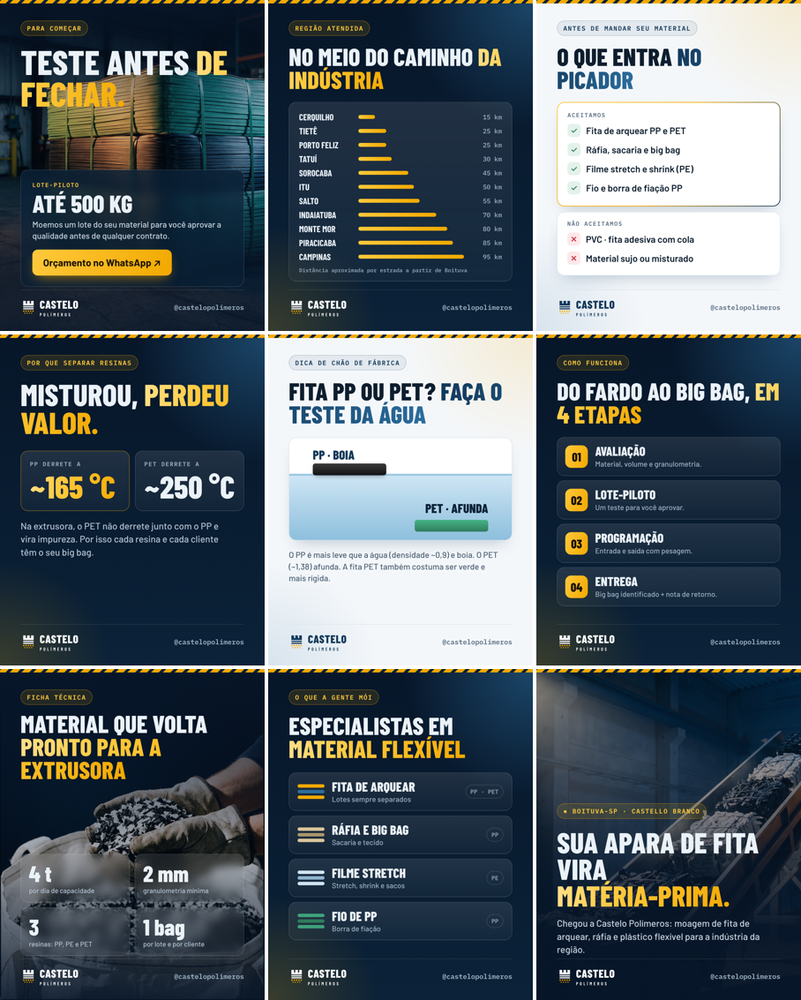
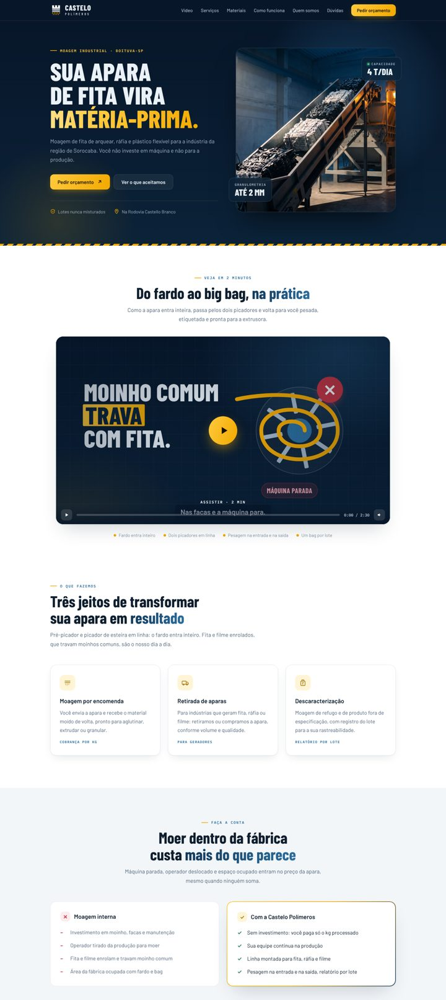
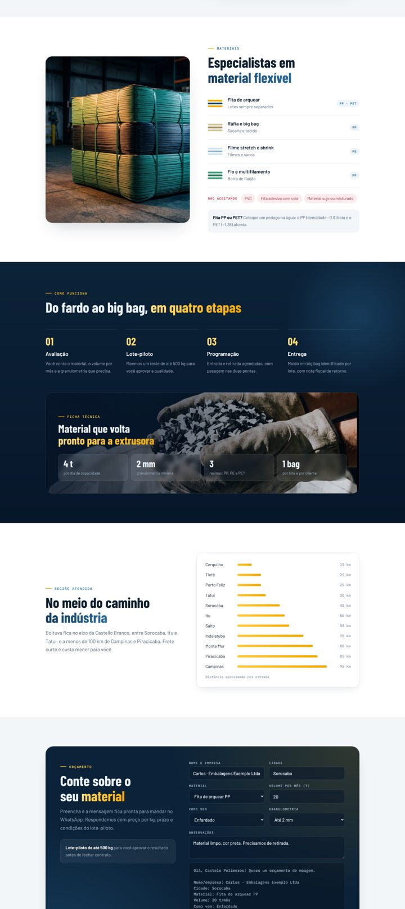
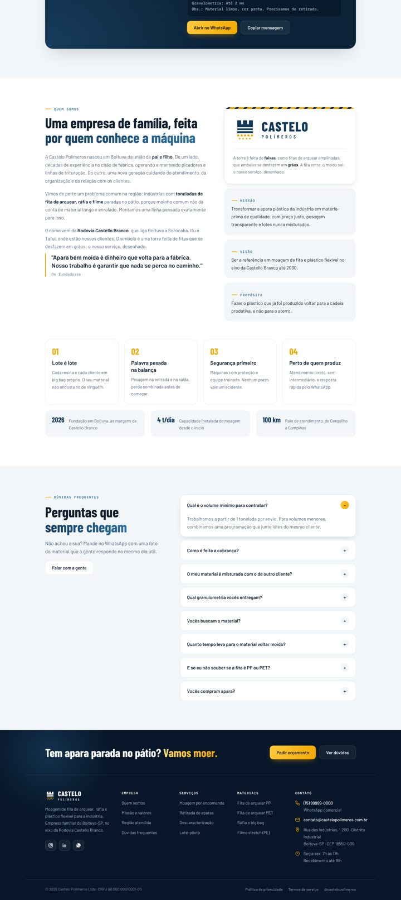
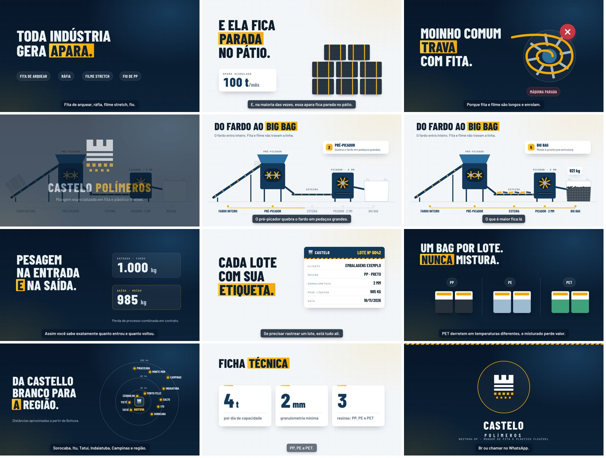

# Castelo Polímeros · Dossiê completo do projeto

*Tudo o que foi criado na conversa com o Claude (outubro de 2026). Para continuar em outra conversa: anexe este arquivo e diga em que ponto quer seguir.*

**Links e arquivos**
- Site publicado (Artifact privado): https://claude.ai/artifact/T3i2S22onev1ypBbBdaMtp
- Todos os arquivos (kit da marca, site, posts, vídeo, planilhas, scripts): branch **`castelo-polimeros`** do repositório GitHub `gabrielduartefaria26-lab/oasis-agendador`, com o resumo técnico em `LEIA-ME_HANDOFF.md`.
- Kit compacto: `Castelo_Polimeros_Kit.zip` (enviado na conversa).

---

## 1. O negócio

**Anotações originais da ideia**
- Montar uma empresa de polímeros com o pai. Matéria-prima: **fita de embalagem**, picada e trabalhada.
- O pai tem o contato de uma empresa que gera **100 t de fita por mês** e quer alguém para cortar.
- O pai tem a máquina: **pré-picador + picador de esteira**. O fardo entra inteiro num túnel, é pré-picado e cai em outro picador que finaliza em **2 mm**. Depois vai para o **big bag**, a empilhadeira leva ao estoque.
- Equipe de **4 pessoas**. Plano: **1 ano só prestando serviço** de moagem.
- Papel do Gabriel: **comercial**, fazer contato com as empresas.

**Capacidade:** até **4 t/dia** → ~**88 t/mês** (22 dias úteis). Não cobre sozinha as 100 t/mês do contato; dá para usar sábados ou turno estendido. Um só cliente ocuparia quase toda a máquina, por isso a lista de prospecção.

**Testar o 2 mm:** é fino para picador (o comum é 8 a 20 mm). Mais fino gasta mais energia e faca. Confirmar com o cliente se 8 a 10 mm basta.

### Que fita é essa? (perguntar ao cliente)
| Tipo | Material | Reciclagem |
|---|---|---|
| Fita de arquear (amarra fardos/paletes) | PP, às vezes PET | Ótima: limpa e de um tipo só |
| Ráfia / fita tecida (sacaria, big bag) | PP | Boa |
| Fita adesiva (durex, fita de caixa) | BOPP + cola | Difícil: a cola contamina |

### Siglas dos plásticos
| Código | Sigla | Onde aparece |
|---|---|---|
| 1 | PET | Garrafas, fita de arquear PET, bandejas |
| 2 | PEAD | Galões, bombonas, caixas |
| 4 | PEBD/PELBD | Filme stretch, sacolas |
| 5 | PP | Fita de arquear, ráfia, big bag, potes |
| 6 | PS/EPS | Isopor, copinhos |
| 3 | PVC | Tubos (evitar: contamina e solta cloro) |
| 7 | Outros | ABS, PC, PA (nylon) |

### Outros materiais
- **Combinam com a máquina (flexível e longo):** filme stretch de PE, big bag e sacaria de ráfia PP, filme encolhível e sacos de PE, fita de arquear PET (sempre separada do PP), fio/multifilamento de PP.
- **Precisariam de moinho de facas (rígido):** bombonas e caixas de PEAD, paletes, peças de PP, borra de injetora, ABS e PC.
- **Regra de ouro:** cada resina em um bag separado e etiquetado. Misturado perde quase todo o valor.

### Equipe (4 pessoas) e segurança
1. **Alimentador:** abre o fardo e alimenta o pré-picador.
2. **Operador da saída:** segundo picador, troca o bag, pesa e etiqueta.
3. **Empilhadeirista:** carga, descarga e estoque.
4. **Líder de turno:** qualidade, manutenção e troca de faca, controle de peso.

**Obrigatório:** NR-12 (proteções, emergência e intertravamento das máquinas), NR-11 (empilhadeira) e EPIs.

---

## 2. Custos e viabilidade (estimativas a confirmar)

| Item | Premissa | Valor |
|---|---|---|
| Mão de obra | 4 × ~R$ 4.000 (custo total) | R$ 16.000/mês |
| Galpão | aluguel | R$ 10.000/mês |
| Empilhadeira | aluguel | R$ 6.000/mês |
| Contador, seguro, licenças etc. |  | R$ 5.000/mês |
| Energia | ~100 kWh/t × R$ 0,80 | R$ 80/t |
| Facas e manutenção |  | R$ 40/t |
| Big bags | 2/t × R$ 30 | R$ 60/t |
| Impostos | Simples, faixa inicial | 10% do faturamento |
| Investimento inicial | NR-12, licenças, balança/elétrica, capital de giro | R$ 100.000 |

**Resultado com R$ 0,80/kg e 80 t/mês:** faturamento R$ 64 mil, **lucro ~R$ 6,2 mil/mês** (sem pró-labore), **custo ~R$ 0,64/kg**, **ponto de equilíbrio ~69 t/mês**, preço mínimo ~R$ 0,71/kg no volume atual. Na projeção de 12 meses com rampa de clientes, o **caixa chega a ~-R$ 138 mil no 3º mês** e fecha o ano em ~-R$ 63 mil.

**Conclusões:** o preço por kg define tudo; o custo fixo pesa (galpão próprio ou empilhadeira usada mudam muito a conta); **ninguém publica preço do serviço**, então é preciso pedir orçamento como cliente comum aos concorrentes. Referência de valor do material: PP moído R$ 4 a 7/kg e flake PET ~R$ 6,90/kg (SP, mai/2025).

A planilha `Viabilidade_Moagem_Castelo_Polimeros.xlsx` tem tudo editável (células amarelas), tabela preço × volume e projeção de 12 meses.

---

## 3. Parte legal e contrato
- **CNPJ:** CNAE principal **3832-7/00** (Recuperação de materiais plásticos) + secundário **4687-7/03** (comércio atacadista de resíduos e sucatas não metálicos).
- **Licenças:** CETESB (prévia, instalação e operação), AVCB/CLCB dos Bombeiros, alvará da prefeitura, laudo NR-12, PGR e PCMSO, cadastro SIGOR/MTR (para emitir MTR e CDF).
- **Nota fiscal:** cliente manda a apara e recebe o moído = **industrialização por encomenda**. No retorno, o insumo volta com **CFOP 5.902** e o serviço é cobrado com **CFOP 5.124**, na mesma nota (SEFAZ-SP, RC 25345/2022). Confirmar com contador.
- **Contrato com o cliente das 100 t:** 12 meses com volume mínimo, preço/kg e forma de pesagem, frete, quem fornece bags, granulometria, perda de processo (1 a 3%), responsabilidade em caso de incêndio.

---

## 4. Cliente ideal e descobertas
- **Arqplast (Boituva)** é **recicladora**, não fábrica de fita: Toyplast Plásticos Ltda, utilidades 100% recicladas, ~250 funcionários, +30 mil t/ano, triagem ótica própria. Tel. (15) 3268-9191.
- **MM Plást (Indaiatuba):** não encontrada com esse nome. No polo do Recreio Campestre Jóia há **Megplast** e **Making Plast**. Confirmar com o pai.
- **Empresa de Monte Mor:** anúncio no MF Rural de quem mói sucata de **fita de arquear PET verde e PP branca**. Pode ser ela.
- **Conclusão:** ICP = **recicladora/granuladora de PP, PE e PET** (prioridade A). Depois: fábricas que geram apara (B) e aparistas/gestoras de resíduo (C).
- **Começar por:** Mastrapet (Iperó), Odin Plast (Porto Feliz), Reciclagem Tietê, BCS (Sorocaba), Dannaplas (Piracicaba, WhatsApp de Compras).

---

## 5. Lista de empresas para ligar (48)
*Telefones de sites e diretórios públicos (out/2026). "não verificado" = conferir no Google Maps. Distâncias aproximadas por estrada a partir de Boituva.*

| Prior. | Empresa | Cidade | Telefone | WhatsApp | E-mail / site | Confiança | Por que ligar |
|---|---|---|---|---|---|---|---|
| REF | Arqplast (Toyplast Plásticos Ltda) | Boituva (~0 km) | (15) 3268-9191 | - | sac@arqplast.com.br · arqplast.com.br | Alta | Referência do perfil de cliente. Tem triagem própria; oferecer moído de PP limpo ou capacidade extra em picos. Perguntar quem gera apara na região. |
| REF | MM Plást (nome a confirmar) | Indaiatuba (~70 km) | não verificado | - | - | Baixa | Confirmar nome exato / CNPJ com seu pai. |
| A | Mastrapet | Iperó (~25 km) | (15) 99151-4210 | (11) 95450-9747 | comercial@mastrapet.com.br · mastrapet.com.br | Alta | Granuladora mais próxima de Boituva e trabalha com PET e PP, os materiais da fita de arquear. |
| A | Odin Plast (Odin Ind. Termoplástica) | Porto Feliz (~25 km) | (15) 3412-3901 | (15) 99125-3504 | contato@odinplast.com.br · odinplast.com.br | Alta | Muito perto; granula PP e PET, então precisa de material moído. |
| A | Reciclagem Tietê / A2 Plastic | Tietê (~25 km) | (15) 3282-8433 | (15) 99858-0343 | comercial@reciclagemtiete.com.br · reciclagemtiete.com.br | Alta | Recebe filme PE de 11 cidades e está ampliando a reciclagem mecânica. |
| A | BCS Plásticos | Sorocaba (~45 km) | (15) 3325-5742 | não verificado | contato@bcsplasticos.com.br · bcsplasticos.com.br | Alta | Capacidade de moagem pequena; vocês fazem isso em uma semana. Pode terceirizar ou comprar moído. |
| A | Cardeal Ind. de Plásticos e Serviços | Elias Fausto (~45 km) | não verificado | - | - | Baixa | Geograficamente ótimo; achar telefone no Google Maps. |
| A | Megplast | Indaiatuba (~70 km) | (19) 3816-1607 / 3816-1577 | (19) 99764-2515 | megplast.com.br | Média | Possível 'MM Plást'. Mesmo perfil de recicladora do polo de Indaiatuba. |
| A | Making Plast | Indaiatuba (~70 km) | (19) 3935-6595 (site) / 3935-6231 | - | contato@makingplast.com.br · makingplast.com.br | Média | Possível 'MM Plást'. Confirmar o que processam. |
| A | Doga Ind. e Com. de Reciclagem Plástica | Indaiatuba (~70 km) | - | (19) 99609-2981 | não verificado | Média | Polo de recicladoras do Recreio Campestre Jóia. |
| A | Reeciclar | Indaiatuba (~70 km) | (11) 93900-5727 | - | não verificado | Baixa-média | Granula PE; ponto de venda para filme moído. |
| A | Valoren Recuperadora de Resíduos | Indaiatuba (~70 km) | (19) 3500-4448 | - | não verificado | Baixa-média | Trabalha com PP/PE, mesmos materiais. |
| A | Petim Ind. e Com. de Plásticos | Itupeva (~75 km) | (11) 98237-0190 | - | petim.com.br | Média | Granuladora que aceita PP e PET. |
| A | Dannaplas | Piracicaba (~85 km) | (19) 3414-3771 | Compras: (19) 99838-6660 · Comercial: (19) 99797-2355 | compras2@dannaplas.com.br · dannaplas.com.br | Alta | Grande e compra sucata de PP/PE. Ligar no WhatsApp de Compras. |
| A | Bonafé Plásticos | Piracicaba (~85 km) | (19) 3185-0465 | (12) 97402-2159 | contato@bonafeplasticos.com.br · bonafeplasticos.com.br | Alta | Compra apara de PP e granula. Comprador do moído ou parceiro de volume. |
| A | Barreflex Reciclagem | Sumaré (~95 km) | (19) 3246-1374 | - | contato@barreflex.com.br · barreflex.com.br | Alta | Forte em filme PE pós-industrial. Bom comprador de filme e ráfia moídos. |
| A | WX8 Plásticos | Campinas (~95 km) | (19) 3216-4699 | (19) 99881-9186 (cel.) | contato@wx8plasticos.com.br · wx8plasticos.com.br | Alta | Consome PE/PP reciclado nos próprios produtos. |
| A | CBJ Reciclagem de Plásticos | Campinas (~95 km) | (19) 3266-8360 | - | contato@cbjreciclagem.com.br · cbjreciclagem.com.br | Alta | Pode terceirizar moagem de PP/PE ou comprar moído. |
| A | Zupiplast | Jundiaí (~95 km) | (11) 4815-3882 | (11) 97144-3164 | zupiplast.com.br | Alta | O moído entra direto na extrusora deles. |
| A | Complast Polímeros | Várzea Paulista (~95 km) | (11) 4596-2525 | (11) 98908-4399 | comercial@complastpolimeros.com.br · complastpolimeros.com.br | Alta | Procura fornecedor mensal de PP/PE. |
| A | Infinity Plastics do Brasil | Santa Bárbara d'Oeste (~100 km) | (19) 3458-5297 | - | não verificado | Média | Polo de recuperadoras de SBO. |
| A | Camplast Recuperadora de Plásticos | Santa Bárbara d'Oeste (~100 km) | (19) 3455-7638 | - | não verificado | Média-baixa | Polo de recuperadoras de SBO. |
| A | Ciel Canova Recuperadora de Plásticos | Santa Bárbara d'Oeste (~100 km) | (19) 3463-7355 | - | não verificado | Média-baixa | Polo de recuperadoras de SBO. |
| A | Primeplas | Itatiba (~110 km) | - | Compras: (11) 94708-4599 · Vendas: (11) 97646-3002 | suprimentos@primeplas.com.br · primeplas.com.br | Alta | Alvo certo para fita de PP e ráfia moídas. Um pouco fora do raio. |
| B | Fibertex Nãotecidos | Cerquilho (~15 km) | (15) 3384-8400 | - | marketing.br@fibertex.com | Média | A empresa mais próxima. Confirmar se a apara é PP ou poliéster/viscose. |
| B | Cipatex | Cerquilho (~15 km) | (15) 3284-9000 | - | cipatex.com.br | Média | Perto, mas é PVC: só vale se aceitarem destino separado. Baixa prioridade. |
| B | Luzplastik | Sorocaba (~45 km) | - | (15) 99676-2445 | luzplastik.com.br | Média | Gera apara de PE e também pode comprar moído. |
| B | Vitopel do Brasil | Votorantim (~50 km) | (15) 3242-9800 (diretório) | - | não verificado | Média | Muito refile de bobina de PP. Pode ter reciclagem interna; oferecer o excedente. |
| B | Strapet Embalagens | Salto de Pirapora (~55 km) | (15) 3500-9776 | (15) 3500-9776 | strapet.com.br | Média-alta | Provável fabricante de fita perto de Boituva; gera apara de PP e PET. |
| B | Nova Têxtil Brasil | Salto de Pirapora (~55 km) | - | (15) 99735-7496 | novatextilbrasil.com.br | Alta | Corte e costura geram retalho de ráfia PP. |
| B | Poly-Plastic | Salto de Pirapora (~55 km) | - | (15) 99794-0675 · (15) 99719-5772 | polyplastic.com.br | Alta | Extrusão de PE: apara e borra de stretch. |
| B | Signode Brasil | Cabreúva (~65 km) | (11) 4529-8400 | - | contato@signode.com.br · signode.com/pt-br | Média | Maior fabricante de arqueação da região. Perguntar se extrudam fita plástica em Cabreúva. |
| B | Finepack | Itupeva (~75 km) | (11) 4496-8800 | (11) 94797-7993 | vendas@finepack.com.br · finepack.com.br | Alta | Apara de filme PE em volume. |
| B | Ecoway | Itupeva (~75 km) | (11) 4496-3764 / 4496-3778 | (11) 91017-8152 | vendas@ecoway.com.br · ecoway.com.br | Alta | Comprador potencial de filme e ráfia moídos. |
| B | Tectêxtil Embalagens Têxteis | Rio das Pedras (~80 km) | (19) 3424-1611 | (19) 99181-8003 | tectextil.com.br | Alta | Grande geradora de apara de ráfia e big bag. |
| B | Grupo Embrasa | Sumaré (~95 km) | (19) 3864-4100 | (19) 99848-3707 | embrasa@embrasa.com.br · embrasa.com.br | Alta | Extrusão de fita + tecelagem = muita apara longa, ideal para o picador de esteira. |
| B | Fábrika do Fitilho | Santana de Parnaíba (~95 km) | (11) 4163-5303 | (11) 94002-8382 | fabrikadofitilho.com.br | Média | Usa PP reciclado: compra moído ou terceiriza moagem do refugo. |
| B | Profil (fios de PP) | Nova Odessa (~100 km) | (19) 3498-1500 | Comercial: (19) 98953-5145 | sac@profil.com.br · profil.com.br | Alta | Borra e apara de fio de PP: material longo, ideal para o picador de esteira. |
| C | Papiro Gestão em Recicláveis | Porto Feliz (~25 km) | (15) 3261-3719 | - | administrativo@papiroreciclagem.com.br · papiroreciclagem.com.br | Média | Perto de Boituva. |
| C | Ecopel | Sorocaba (~45 km) | (15) 3033-2326 | (15) 99885-4274 | comercial@ecopel.eco.br · ecopel.eco.br | Alta | Moído vale mais na revenda; pode contratar moagem. |
| C | PSA Reciclagem | Sorocaba (~45 km) | - | (15) 99151-2798 | psareciclagem.com.br | Alta | Junta filme PE, um dos materiais de vocês. |
| C | Grupo Salmeron | Sorocaba (~45 km) | (15) 3232-2425 | (15) 99133-8728 | comercial@gruposalmeron.com.br · gruposalmeron.com.br | Alta | Grande volume industrial; pode terceirizar moagem. |
| C | Grupo DS Ambiental | Sorocaba (~45 km) | (15) 3227-7922 / 3227-7906 | - | contato@dsambiental.com.br · dsambiental.com.br | Média-alta | Pode terceirizar picos de moagem. |
| C | Alp Ambiental | Sorocaba (~45 km) | (15) 3225-2259 | - | alpambiental.com.br | Baixa-média | Confirmar se ainda está ativa. |
| C | Aparas Rosário Pereira | Itu (~50 km) | (11) 4022-3343 | (11) 94558-8360 | contato@aparasrosariopereira.com.br · aparasrosariopereira.com.br | Alta | Hoje só enfarda; moer agregaria valor ao plástico deles. |
| C | Anunciante de moagem de fita PET/PP (MF Rural) | Monte Mor (~80 km) | não verificado | - | Formulário 'Fale com o anunciante' no MF Rural | Média | Trabalha exatamente com fita. Pode ser a 'empresa de Monte Mor'. Parceiro de volume ou concorrente. |
| C | Eco Sucatas | Nova Odessa (~100 km) | (19) 3476-3000 | (19) 99273-4670 | comercial@sucataseco.com.br · sucataseco.com.br | Média | Volume de plástico enfardado. |
| C | Tombstone Reciclagem | Paulínia (~105 km) | (19) 3933-3593 / 3933-2650 | - | tombstonereciclagem@uol.com.br | Média | Aparista regional. |

---

## 6. Concorrentes (17)
| Empresa | Cidade | Perfil | Serviços | Telefone | Como vendem | Brecha |
|---|---|---|---|---|---|---|
| Alassia | Sorocaba (~45 km) | Moagem/granulação para terceiros + compra apara | Moagem (3 moinhos + triturador de borra), granulação, micronização; 'industrialização para terceiros' | (15) 3223-1338 / 3223-1470 (WhatsApp) | Presta serviço E compra apara/refugo | Não divulga preço |
| Poliplástico Sorocaba | Sorocaba (~45 km) | Recicladora que compra apara | Moagem, aglutinação, regranulação, descaracterização; fabrica cantoneira CantonPlast | (15) 99127-1772 (não verificado) | Compra resíduo pós-industrial (tem 'compradora de resíduos') | Site fora do ar |
| BCS Plásticos | Sorocaba (~45 km) | Recicladora que compra apara | Coleta programada, triagem, lavagem, moagem, granulação; CETESB | (15) 3325-5742 | Compra apara ('vender resíduo' no formulário); resposta em 24 h | Capacidade pequena; sem redes; sem preço |
| DS Ambiental | Sorocaba (~45 km) | Gestora de resíduos | Gestão total, descaracterização/destruição, coleta com frota (roll-on), compra de recicláveis | (15) 3227-7922 / 3227-7906 | Vende conformidade: certificado de destinação, laudo, rastreabilidade, 'Aterro Zero' | Moagem de plástico não é o foco; pode virar parceira |
| Ecopel | Sorocaba (~45 km) | Aparista + descaracterização | Compra e venda de aparas, descaracterização com triturador e prensa, coleta com caçamba | (15) 3033-2326 | Cliente pode acompanhar a descaracterização | Presença online fraca/desatualizada |
| Moagem PP e PEAD (anônimo B2Blue) | Sorocaba (~45 km) | Moageiro comprador | Compra PP enfardado, 'PP boca de moinho' e PEAD; vende moído/granulado | Oculto (precisa cadastro na B2Blue) | Se apresenta como comprador, não prestador | Anônimo |
| Flex Ambiental | Salto (~55 km) | Moagem/descaracterização + gestão | Moagem e descaracterização de borra, peça e sobra industrial; compra e venda de insumos | (11) 94214-7251 (WhatsApp) | ISO 9001, selo ESG, 'zero aterro', +20 anos, visita técnica | Não divulga preço |
| Megplast | Indaiatuba (~70 km) | Beneficiamento para terceiros | Recebe, separa, beneficia e devolve matéria-prima; descaracterização | (19) 3816-1607 / 3816-1577 | Industrialização por encomenda | Site instável |
| Gedel Plásticos | Piracicaba (~85 km) | Industrialização por encomenda | Coleta, moagem, secagem, dupla granulação, pigmentação; devolve grão em big bag de 1 t | (19) 3438-7211 (WhatsApp) | 'Redução de custo e reaproveitamento'; cliente recebe o grão de volta | Foco em granulado, não moagem simples |
| Plásticos Barrichello | Piracicaba (~85 km) | Prestação de serviço de moagem | Moagem de PEAD, trituração de borra, refugo e peça grande; lavagem; granulometria padronizada | (19) 97107-9516 (WhatsApp) | 'Solicitar orçamento' | Foco em rígidos, não fita/filme |
| CBJ Reciclagem | Campinas (~95 km) | Recicladora + coleta | Triagem, moagem, retirada de metal, extrusão, granulação; frota e roll-on | (19) 3266-8360 | 'Recicle os resíduos da sua empresa'; não deixa claro se cobra ou compra | Pouca rede social |
| Tombstone | Paulínia (~105 km) | Aparista / gestão | Coleta, enfardamento, compra e venda de resíduo industrial | (19) 3933-3593 | Página por cidade (Tatuí, Boituva, Cerquilho...) | Não faz moagem como serviço |
| Nicoplas Moagem | Cajamar (~110 km) | Só presta serviço (melhor exemplo) | Moagem, granulação PE/PP, micronização; moinhos de 1.200 kg/h; peneira por granulometria; 'moagem programada' | (11) 2483-1829 · (11) 97272-9770 | 'Aumente sua margem sem parar a produção, sem investir em máquinas'; caçamba + big bag identificado; depoimentos | Não divulga preço |
| Trevo Reciclagem | Embu das Artes (~130 km) | Moagem e lavagem | Serviço de moagem e lavagem de PCR PP/PE; descaracterização | (11) 3589-0089 · (11) 96647-5572 | Presença social mais completa | - |
| Plasticosp | Mairiporã (~130 km) | Mão de obra de granulação | Granulação de PS, PEBD, PEAD; aglutinação do material do cliente | (11) 4486-4807 · (11) 97665-8175 | Vende 'mão de obra' explicitamente | - |
| RFX Reciclagem | Bragança Paulista (~140 km) | Moagem + lavagem + granulação | Moinho de facas e de borra, lavagem, granulação | (11) 4033-2104 · (11) 98324-0826 | Divulga números (toneladas) e horário de recebimento | - |
| Recomplast | Santana de Parnaíba (~95 km) | SEO de 'serviço de moagem' | Páginas 'serviço de moagem de plástico em [cidade]' para centenas de cidades | (11) 4705-9053 | Captura buscas de Itu, Salto, Porto Feliz, Capivari | Sem preço, sem CDF |

**O que os concorrentes fazem bem**

- Logística como produto: caçamba roll-on, coleta programada, big bag identificado (Nicoplas, BCS, DS, Ecopel, CBJ).
- Conformidade como argumento de venda: CETESB, ISO, certificado de destinação, laudo, descaracterização acompanhada (DS, Flex, Ecopel).
- Promessa econômica clara: 'sem investir em máquina e sem parar a produção' (Nicoplas, Gedel).
- Recorte claro: dizem qual material aceitam e o que NÃO fazem (Nicoplas, Barrichello).
- Prova: toneladas processadas, kg/h, anos de mercado, depoimentos.

**Brechas que vocês podem aproveitar**

- Ninguém publica preço. Uma tabela simples (a partir de R$ X/kg, mínimo Y kg, prazo Z dias) já diferencia.
- Ninguém é especialista em FITA DE ARQUEAR, RÁFIA e FILME: a maioria foca em rígidos, PEAD e borras. Posicionem-se como 'especialistas em moagem de fita e plástico flexível'.
- Granulometria quase nunca é informada. Divulgar 'moído 2 mm padronizado' com foto e ficha técnica.
- CDF/MTR quase não é citado. Oferecer MTR via SIGOR + Certificado de Destinação Final + fotos resolve a dor do gerador.
- WhatsApp e redes fracos nos concorrentes locais (BCS e Ecopel sem redes; Ecopel com site de 2018; Poliplástico fora do ar).
- Faixa Boituva, Tatuí, Cerquilho, Tietê e Porto Feliz sem prestador visível: quem aparece no Google são portais de longe. Google Meu Negócio + páginas 'moagem de plástico em Tatuí/Cerquilho...' têm boa chance de ranquear.
- Moagem pura por kg, com o material voltando ao cliente, é pouco ofertada: os grandes empurram granulação completa ou compram a apara.

**Referências de preço (todas a confirmar)**

- Preço de SERVIÇO de moagem por kg não é publicado por ninguém: todos trabalham sob orçamento.
- Próximo passo: pedir orçamento como cliente comum (Nicoplas, Flex, Gedel, Barrichello, Plasticosp, Alassia): R$/kg, lote mínimo, frete.
- Preço do material moído em classificados: PP moído R$ 4 a 7/kg; PET moído ~R$ 8,90/kg. É a margem que justifica o serviço para o cliente.
- Custo estimado de vocês (conversa anterior): ~R$ 0,55/kg. Preço de serviço precisa ficar acima disso.

**Nota fiscal (confirmar com contador)**

- Cliente manda a apara e recebe o moído = industrialização por encomenda.
- No retorno: insumo volta com CFOP 5.902 e o serviço é cobrado com CFOP 5.124, na mesma nota (SEFAZ-SP, RC 25345/2022).

---

## 7. Roteiro de ligação
- **Abertura:** "Bom dia, meu nome é ___, sou da Castelo Polímeros, de Boituva. Com quem eu falo sobre aparas, resíduos ou compra de material reciclado? Somos especializados em moagem de fita de arquear, ráfia e plástico flexível. Moemos até 4 t por dia, até 2 mm, e entregamos em big bag."
- **Perguntas:** gera ou compra apara de fita/ráfia/filme? Quantas t/mês? Quem mói hoje? A moagem está no limite? Que granulometria, resina e cor? Como vem (fardo, bobina, solto)? Quem faz o frete? Precisa de MTR/CDF?
- **Proposta:** (1) manda a apara e recebe o moído, cobrança por kg; (2) se for gerador, compramos ou retiramos a apara. Oferecer **lote de teste de 500 kg**.
- **Fechamento:** pedir o melhor contato para mandar proposta; anotar nome, cargo, volume e próximo passo.
- **Dicas:** ligar das 9h às 11h30 ou das 14h às 16h30. Em fábrica, pedir "resíduos" ou "meio ambiente"; em recicladora, "compras" ou "produção". Sem interesse? "Conhece quem gera ou compra esse tipo de apara?"

---

## 8. A marca


- **Nome: Castelo Polímeros.** "Castelo" vem da **Rodovia Castello Branco**: Boituva e quase todos os clientes (Sorocaba, Itu, Porto Feliz, Tatuí) estão nela. Fácil de falar e passa solidez. "Polímeros" soa como indústria, não ferro-velho. Domínio castelopolimeros.com.br estava livre. Alternativas: Faria Polímeros, Ciclofita, Picaplast, Castelo Moagem. **Falta checar no INPI** (classe 40).
- **Logo:** torre de castelo feita de **faixas** (fitas de arquear empilhadas) que embaixo se desfazem em **grãos** (o moído). Ou seja: a fita entra, o moído sai. Feito só de retângulos: funciona pequeno, é barato de pintar, bordar e adesivar, e os quadradinhos lembram pellets. Não usa o símbolo ♻ porque todo concorrente usa e ele fala com o consumidor, não com o comprador.
- **Cores:** Azul Castelo #12385A (principal: indústria, confiança) · Azul Noite #0B2238 e #071629 (fundos escuros) · **Âmbar Fita #F2A900** (destaque: cor da fita de arquear e da faixa de segurança; gradiente com #FFC93C) · Concreto #EEF1F4/#F3F6F9 · Grafite #17232D · Verde Ciclo #2F7D5B (só "aceitamos" e PET). Por que não verde como principal: 9 em cada 10 recicladoras usam verde.
- **Fontes (Google Fonts, grátis, existem no Canva):** Barlow Condensed (títulos, cara de placa/estêncil), Barlow (texto), IBM Plex Mono (números e rótulos, cara de ficha técnica).
- **Elemento gráfico:** faixa listrada diagonal âmbar/azul (fita zebrada + fita de arquear).
- **Tom de voz:** direto e técnico (kg, mm, t/dia), linguagem de chão de fábrica, prova concreta (pesagem, lote, teste), educativo. Evitar: prometer o que ainda não tem (licença), "sustentabilidade" genérica, gíria, falar mal de concorrente.
- **Aplicações prontas no manual:** cartão de visita, **etiqueta de big bag A5** (cliente, resina, cor, granulometria, peso, data, NF), uniforme, fachada, caminhão, assinatura de e-mail.
- **Preferências do Gabriel:** acabamento sofisticado no nível de cargobooking.com.br/novo (gradientes, fotos, cards de vidro, selos), **mantendo a identidade**; **muito branco e respiro** (todo escuro ficou pesado); header fixo sólido azul-noite; margens laterais generosas; mobile bem cuidado.

---

## 9. Instagram


- **@castelopolimeros** (alternativas: @castelo.polimeros, @castelopolimeros.sp). Conta profissional, categoria "Serviço de reciclagem".
- **Bio:** Castelo Polímeros · ♻️ Moagem de fita de arquear, ráfia e filme · ⚙️ PP · PE · PET · até 2 mm · 4 t/dia · 📍 Boituva-SP · Castello Branco · 👇 Orçamento no WhatsApp · castelopolimeros.com.br
- **Destaques:** Serviços · Materiais · Como funciona · Região · Contato.
- **Estilo dos posts (v2):** fundo azul-noite com brilhos azul e âmbar, selos em pílula, cards de vidro, palavras em gradiente âmbar, fotos em 3 posts (1, 3 e 9) e 2 posts claros (5 e 7) para o grid respirar.
- **Publicação:** ordem 01 → 09, 3 por semana (seg, qua, sex). Criar o perfil já para reservar o nome, mas só postar perto da operação.
- **Depois dos 9:** Reels do fardo entrando e saindo moído (o conteúdo mais forte), antes e depois, stories de bastidores, carrosséis técnicos. Sempre com EPI e sem marca de cliente sem autorização.



### Legendas dos 9 posts
```
===== POST 01 (Seg · semana 1) =====
Chegou a Castelo Polímeros. 🏭

Somos uma empresa familiar de Boituva, às margens da Castello Branco, especializada em moagem de fita de arquear, ráfia e plástico flexível.

Sua apara vira matéria-prima padronizada, sem você investir em máquina nem parar a produção.

📲 Orçamento pelo WhatsApp: link na bio.

#reciclagem #reciclagemdeplastico #moagemdeplastico #fitadearquear #rafia #filmestretch #polipropileno #economiacircular #industria #boituva #sorocaba #regiaodesorocaba

===== POST 02 (Qua · semana 1) =====
O que a gente mói:

▪ Fita de arquear PP e PET
▪ Ráfia, sacaria e big bag
▪ Filme stretch, shrink e sacos de PE
▪ Fio e borra de fiação de PP

Nosso equipamento recebe o fardo inteiro. Fita e filme enrolados, que travam moinho comum, são o nosso dia a dia.

#reciclagem #reciclagemdeplastico #moagemdeplastico #fitadearquear #rafia #filmestretch #polipropileno #economiacircular #industria #boituva #sorocaba #regiaodesorocaba

===== POST 03 (Sex · semana 1) =====
Capacidade de 4 toneladas por dia, granulometria até 2 mm e entrega em big bag identificado por lote.

PP, PE e PET sempre separados. Seu material volta do jeito que entrou, só que moído.

#reciclagem #reciclagemdeplastico #moagemdeplastico #fitadearquear #rafia #filmestretch #polipropileno #economiacircular #industria #boituva #sorocaba #regiaodesorocaba

===== POST 04 (Seg · semana 2) =====
Como funciona, do fardo ao big bag:

1. Avaliação: você conta material, volume e granulometria.
2. Lote-piloto: moemos um teste para você aprovar.
3. Programação: entrada e saída agendadas, com pesagem.
4. Entrega: moído em big bag identificado, com nota de retorno.

#reciclagem #reciclagemdeplastico #moagemdeplastico #fitadearquear #rafia #filmestretch #polipropileno #economiacircular #industria #boituva #sorocaba #regiaodesorocaba

===== POST 05 (Qua · semana 2) =====
Dica de chão de fábrica: fita PP ou PET? 💧

Coloque um pedaço na água. O PP é mais leve que a água (densidade ~0,9) e boia. O PET (~1,38) afunda. A fita PET também costuma ser verde e mais rígida.

Salve para mostrar para a equipe.

#reciclagem #reciclagemdeplastico #moagemdeplastico #fitadearquear #rafia #filmestretch #polipropileno #economiacircular #industria #boituva #sorocaba #regiaodesorocaba

===== POST 06 (Sex · semana 2) =====
Por que a gente nunca mistura resinas?

O PP derrete por volta de 165 °C e o PET por volta de 250 °C. Na extrusora, o PET não derrete junto e vira impureza no produto.

Por isso cada resina e cada cliente têm o próprio big bag.

#reciclagem #reciclagemdeplastico #moagemdeplastico #fitadearquear #rafia #filmestretch #polipropileno #economiacircular #industria #boituva #sorocaba #regiaodesorocaba

===== POST 07 (Seg · semana 3) =====
Antes de mandar seu material:

✅ Aceitamos: fita de arquear PP e PET, ráfia e big bag, filme stretch e shrink, fio de PP.
❌ Não aceitamos: PVC, fita adesiva com cola, material sujo ou misturado.

Ficou em dúvida? Manda uma foto no WhatsApp.

#reciclagem #reciclagemdeplastico #moagemdeplastico #fitadearquear #rafia #filmestretch #polipropileno #economiacircular #industria #boituva #sorocaba #regiaodesorocaba

===== POST 08 (Qua · semana 3) =====
Boituva fica no meio do caminho da indústria: 15 km de Cerquilho, 45 km de Sorocaba, 50 km de Itu, 70 km de Indaiatuba e menos de 100 km de Campinas e Piracicaba.

Frete curto é custo menor para você.

#reciclagem #reciclagemdeplastico #moagemdeplastico #fitadearquear #rafia #filmestretch #polipropileno #economiacircular #industria #boituva #sorocaba #regiaodesorocaba

===== POST 09 (Sex · semana 3) =====
Teste antes de fechar. 🤝

Moemos um lote-piloto de até 500 kg do seu material para você aprovar a qualidade antes de qualquer contrato.

📲 Chama no WhatsApp: link na bio.

#reciclagem #reciclagemdeplastico #moagemdeplastico #fitadearquear #rafia #filmestretch #polipropileno #economiacircular #industria #boituva #sorocaba #regiaodesorocaba
```

---

## 10. Site

Link: https://claude.ai/artifact/T3i2S22onev1ypBbBdaMtp (privado; compartilhar pelo menu da página). Arquivo para hospedar: `site/index.html` do kit. Trocar antes de publicar: número do WhatsApp (`const WHATSAPP`), telefone, e-mail, endereço, CNPJ, história, prazos do FAQ (**tudo inventado/provisório**).

**Seções, nesta ordem**
1. **Header fixo** sólido azul-noite: logo, menu (Vídeo, Serviços, Materiais, Como funciona, Quem somos, Dúvidas) e botão "Pedir orçamento".
2. **Hero (escuro):** "Sua apara de fita vira matéria-prima." + foto da linha + selos flutuantes "4 T/DIA" e "ATÉ 2 MM".
3. **Vídeo animado (2ª dobra):** "Veja em 2 minutos · Do fardo ao big bag, na prática", player próprio com play/pause, barra e som.
4. **Serviços:** moagem por encomenda (por kg), retirada de aparas (para geradores), descaracterização (relatório por lote).
5. **Faça a conta:** moagem interna × Castelo Polímeros.
6. **Materiais:** fita PP/PET, ráfia e big bag, filme stretch/shrink, fio. Não aceitamos PVC, fita adesiva, material sujo/misturado. Dica do teste da água.
7. **Como funciona (escuro):** avaliação → lote-piloto → programação → entrega, + ficha técnica sobre foto (4 t, 2 mm, 3 resinas, 1 bag por lote).
8. **Região:** barras de distância (Cerquilho 15 km … Campinas 95 km).
9. **Orçamento:** formulário que monta a mensagem e abre no WhatsApp (ou copia).
10. **Quem somos:** história de pai e filho, card branco com logo, frase dos fundadores, missão, visão, propósito, 4 valores (Lote é lote · Palavra pesada na balança · Segurança primeiro · Perto de quem produz) e marcos (2026, 4 t/dia, 100 km).
11. **FAQ (8):** volume mínimo, cobrança, mistura de lotes, granulometria, retirada, prazo, PP ou PET, compra de apara.
12. **Rodapé completo:** chamada final, logo, redes, colunas Empresa/Serviços/Materiais, contato com horário, CNPJ e links legais.





---

## 11. Vídeo animado do processo
- Feito em código (estilo inspirado no VSL de konesales.com.br: tipografia cinética com marca-texto, cenas escuras/claras, diagramas que se montam), com as cores e fontes da Castelo. Toca direto no site e exporta MP4 1080p.
- **Versão atual:** narração "à prova de idiotas" (explica o porquê de cada etapa), **legendas na tela** e card que explica cada máquina na cena do processo. ~2:30.
- **Narração:** a voz Microsoft foi reprovada e removida. O Gabriel quer **ElevenLabs, voz "Spuds Oxley - Grandpa"**, sem tom muito idoso (Stability ~50%, Speed ~1.05, modelo v3 com tags). A sessão na nuvem não alcança o navegador nem tem chave da API. Para fazer: gerar as 12 falas e sincronizar, ou rodar o Claude no Mac com o Claude no Chrome.
- **Passos depois do áudio:** cortar silêncio das pontas; duração de cada cena = max(atual, 0,35 + fala + 0,6); montar trilha (adelay + loudnorm); embutir no site (`HAS_AUDIO = true`); exportar MP4 narrado; oferecer versão 9:16 para Reels.



### Cenas e falas
| # | Cena | Duração | Fala / legenda |
|---|---|---|---|
| 01 | Abertura: toda indústria gera apara | 9.8 s | Toda fábrica que usa plástico gera sobra. Fita de arquear, ráfia, filme stretch, fio. No setor, essa sobra tem nome: apara. |
| 02 | Pátio: apara parada | 10.2 s | E, na maioria das vezes, essa apara fica parada no pátio. Ocupa espaço, junta poeira e vira custo, quando poderia virar dinheiro. |
| 03 | Problema: moinho comum trava | 10.1 s | Por que ninguém resolve? Porque fita e filme são longos e enrolam. No moinho comum, eles se enroscam nas facas e a máquina para. |
| 04 | Logo se montando | 7.8 s | A Castelo Polímeros nasceu exatamente pra isso: moer fita e plástico flexível, do jeito certo. |
| 05 | Processo: do fardo ao big bag | 29.0 s | Funciona assim. O fardo entra inteiro, do jeito que sai da sua fábrica, sem precisar desmanchar. O pré-picador quebra o fardo em pedaços grandes. A esteira leva esses pedaços até o picador, que corta fino. Embaixo dele tem uma peneira: só passa o que tem até dois milímetros. O que é maior fica lá dentro até ser cortado de novo. No final, o material cai moído, direto no big bag, pronto pra extrusora. |
| 06 | Pesagem na entrada e na saída | 14.3 s | Antes de começar, a gente pesa o seu material. Depois de moído, pesa de novo. Assim você sabe exatamente quanto entrou e quanto voltou. E a perda do processo já fica combinada em contrato. |
| 07 | Etiqueta do lote | 11.2 s | Cada big bag sai com uma etiqueta: nome do cliente, tipo de plástico, tamanho do grão, peso e data. Se precisar rastrear um lote, está tudo ali. |
| 08 | Um bag por lote, nunca mistura | 14.8 s | E o mais importante: o seu material nunca se mistura com o de outro cliente. Também não misturamos tipos de plástico, porque PP e PET derretem em temperaturas diferentes, e misturado perde valor. |
| 09 | Mapa da região (raio de 100 km) | 11.5 s | Ficamos em Boituva, às margens da Castello Branco. Daqui, atendemos um raio de cem quilômetros: Sorocaba, Itu, Tatuí, Indaiatuba, Campinas e região. |
| 10 | Ficha técnica | 9.5 s | Em números: capacidade de quatro toneladas por dia, grão de até dois milímetros e três tipos de plástico: PP, PE e PET. |
| 11 | Lote-piloto + botão de orçamento | 11.6 s | Quer ver antes de fechar? Você manda até quinhentos quilos, a gente mói, e você testa na sua máquina. Aprovou? Aí sim a gente conversa sobre contrato. |
| 12 | Encerramento com logo | 10.8 s | Pra pedir orçamento, é só acessar castelopolimeros.com.br ou chamar no WhatsApp. Castelo Polímeros: sua apara de volta como matéria-prima. |

### Roteiro para o ElevenLabs (com tags)
```
ROTEIRO DE NARRAÇÃO · CASTELO POLÍMEROS (ElevenLabs, voz Spuds Oxley)
Ajustes: Stability ~50% (Natural) · Speed ~1.05 · modelo Eleven v3 (para as tags entre colchetes).
Gerar uma fala por vez e salvar como 01.mp3 ... 12.mp3.

01 [confident] Toda fábrica que usa plástico gera sobra. [short pause] Fita de arquear, ráfia, filme stretch, fio. [short pause] No setor, essa sobra tem nome: apara.
02 [warm] E, na maioria das vezes, essa apara fica parada no pátio. Ocupa espaço, junta poeira e vira custo... quando poderia virar dinheiro.
03 [matter-of-fact] Por que ninguém resolve? [short pause] Porque fita e filme são longos e enrolam. No moinho comum, eles se enroscam nas facas e a máquina para.
04 [confident] A Castelo Polímeros nasceu exatamente pra isso: moer fita e plástico flexível, do jeito certo.
05 [calm] Funciona assim. [short pause] O fardo entra inteiro, do jeito que sai da sua fábrica, sem precisar desmanchar. O pré-picador quebra o fardo em pedaços grandes. A esteira leva esses pedaços até o picador, que corta fino. Embaixo dele tem uma peneira: só passa o que tem até dois milímetros. O que é maior fica lá dentro até ser cortado de novo. [short pause] No final, o material cai moído, direto no big bag, pronto pra extrusora.
06 [confident] Antes de começar, a gente pesa o seu material. Depois de moído, pesa de novo. Assim você sabe exatamente quanto entrou e quanto voltou. E a perda do processo já fica combinada em contrato.
07 [warm] Cada big bag sai com uma etiqueta: nome do cliente, tipo de plástico, tamanho do grão, peso e data. Se precisar rastrear um lote, está tudo ali.
08 [firm] E o mais importante: o seu material nunca se mistura com o de outro cliente. Também não misturamos tipos de plástico, porque PP e PET derretem em temperaturas diferentes... e misturado perde valor.
09 [warm] Ficamos em Boituva, às margens da Castello Branco. Daqui, atendemos um raio de cem quilômetros: Sorocaba, Itu, Tatuí, Indaiatuba, Campinas e região.
10 [confident] Em números: capacidade de quatro toneladas por dia, grão de até dois milímetros e três tipos de plástico: PP, PE e PET.
11 [friendly] Quer ver antes de fechar? [short pause] Você manda até quinhentos quilos, a gente mói, e você testa na sua máquina. Aprovou? Aí sim a gente conversa sobre contrato.
12 [proud] Pra pedir orçamento, é só acessar castelopolimeros ponto com ponto br, ou chamar no WhatsApp. [short pause] Castelo Polímeros: sua apara de volta como matéria-prima.
```

---

## 12. Fotos e imagens
- 3 fotos geradas por IA no Gamma (esteira com fardos de fita, mão com luva segurando o moído sobre big bag, fardos de fita PET verde e PP preta). **Provisórias:** trocar por fotos reais da máquina do pai. Os créditos gratuitos do Gamma acabaram.

---

## 13. Checklist para montar o negócio
1. **Decisões da família (semanas 1–2):** nome final (INPI + Junta), sociedade pai e filho (percentuais, administrador, pró-labore), galpão com zoneamento industrial (consulta de viabilidade), contador, orçamento real na planilha.
2. **Formalização (semanas 2–4):** CNPJ, CNAEs 3832-7/00 e 4687-7/03, inscrição estadual, regime tributário, conta PJ, pedido de marca no INPI.
3. **Licenças e segurança (meses 1–3):** CETESB, AVCB/CLCB, alvará, laudo NR-12, PGR/PCMSO, NR-11, SIGOR/MTR, seguro.
4. **Presença digital (já):** domínio (registro.br, ~R$ 40/ano), e-mail profissional, WhatsApp Business, Instagram (reservar), site no ar (Netlify grátis ou hospedagem), Google Meu Negócio, LinkedIn, vitrines (B2Blue, MF Rural, ENF).
5. **Material físico (antes do 1º cliente):** etiqueta de big bag, cartão, uniforme/EPI com logo, placa, modelo de proposta, modelo de contrato.
6. **Lançamento comercial (com licença):** ligações pela prioridade A, orçamento com concorrentes, lote-piloto com o 1º cliente (gravar vídeo), publicar os 9 posts.

---

## 14. Pendências e próximos passos
- [ ] Narração no ElevenLabs (voz Spuds Oxley) → sincronizar → som no site → MP4 final → versão 9:16.
- [ ] Confirmar nome no INPI; registrar domínio e @castelopolimeros.
- [ ] Confirmar "MM Plást" e a empresa de Monte Mor com o pai.
- [ ] Perguntar à empresa das 100 t: tipo de fita, apara ou usado, fardo, destino do picado, quanto pagam hoje.
- [ ] Confirmar com o pai: kg/h reais com fita, potência dos motores, proteções NR-12.
- [ ] Pedir orçamento aos concorrentes para descobrir o preço por kg; atualizar a viabilidade.
- [ ] Trocar dados provisórios do site e as fotos de IA por fotos reais.
- [ ] Mensagens prontas de WhatsApp para os clientes (não feitas ainda).

## 15. Fontes da pesquisa
- MF Rural (PP moído, plásticos reciclados, anúncio de Monte Mor): https://www.mfrural.com.br/busca/pp-moido · https://www.mfrural.com.br/detalhe/235691/sucatas-de-fitas-de-arquear-pet
- S&P Global (R-PET Brasil, mai/2025): https://www.spglobal.com/energy/en/news-research/latest-news/chemicals/053025-brazils-r-pet-flake-to-virgin-spread-turns-negative-prompts-recyclers-to-raise-june-rates
- Arqplast: https://www.arqplast.com.br/sobrenos/ · AFIPOL associados: https://www.afipol.org.br/afipol_associados.php · ENF Recycling: https://www.enfplastic.com
- Sites das empresas listados nas tabelas acima (coluna "E-mail / site").
